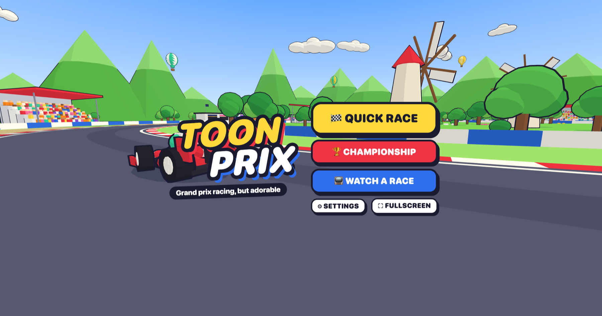
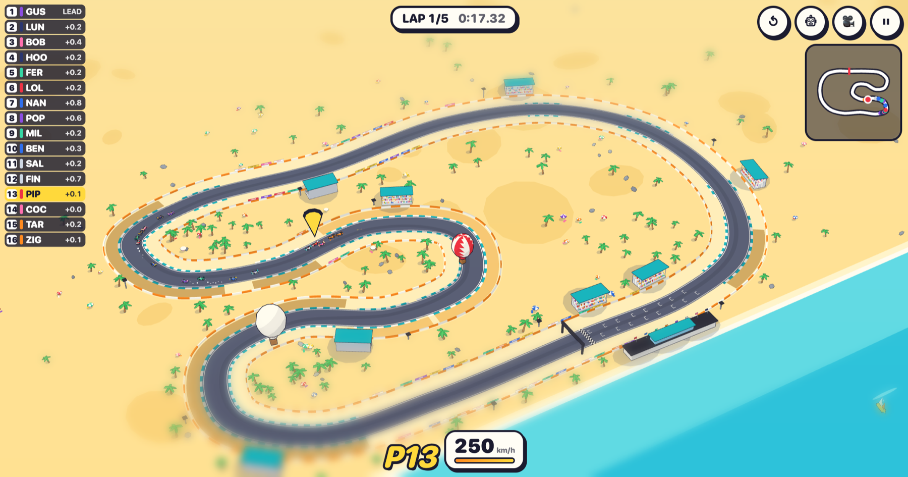
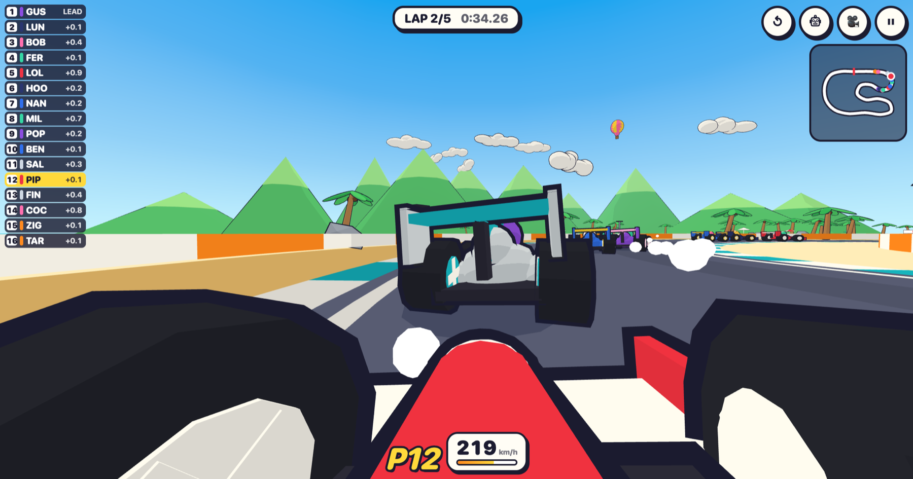

# Toon Prix

A cute comic-style 3D grand prix game for the browser (desktop, iPhone, foldables). No build step, no assets:
everything is generated in code with three.js (vendored in `js/lib`).

**Play it: https://alexkli.github.io/toon-prix/**

| Mini Circuit view | Driver's-eye view |
| --- | --- |
|  |  |

Run: serve this folder over HTTP (ES modules need it), e.g. `python3 -m http.server 8765`, then open
`http://localhost:8765/`. On iPhone use Share → Add to Home Screen for true full screen.

- Modes: Quick Race, Championship (6 rounds, 3 save slots), fully automatic "Watch a Race"; autopilot toggle while driving.
- Cameras: Chase, Onboard, TV, Helicopter, Drone, Mini Circuit (tilt-shift model-railway view), Director.
- Replay: every race is recorded; "Replay" on the results screen plays it back with any camera, pause, 0.25×–4× speed and a scrub bar.
- Saving: localStorage. Championships auto-save after each race; a race in progress is saved on "Save & quit" or when the page is hidden.
- Sound: synthesised engines and procedural background music. Optional Spotify soundtrack: sign in from Settings (OAuth PKCE, Spotify Premium; plays via the Web Playback SDK or a running Spotify app). The Spotify app's redirect URI must be the page URL, e.g. `https://alexkli.github.io/toon-prix/`.
- Keys: arrows/WASD, Space boost, C camera, T autopilot, R reset, P pause, M mute.

Code map: `data.js` (teams, drivers, circuits) · `trackmath.js` (spline, racing line, speed profile) · `world.js`/`props.js` (scenery) ·
`car.js` (model, physics, AI) · `race.js` (rules, collisions, save/restore) · `cameras.js` · `ui.js` (menus, HUD) · `main.js`.
`node tools/check-tracks.mjs` validates circuit layouts.

---

Created with Claude Fable 5.2 (Anthropic), from design and feedback by Alexander Klimetschek. All code, circuits, art and music were generated in conversation; no hand-written code or external assets apart from three.js. Every prompt used is in [PROMPTS.md](PROMPTS.md).
